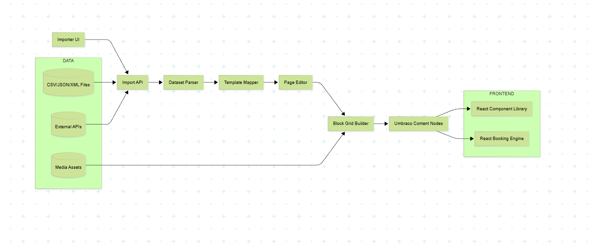
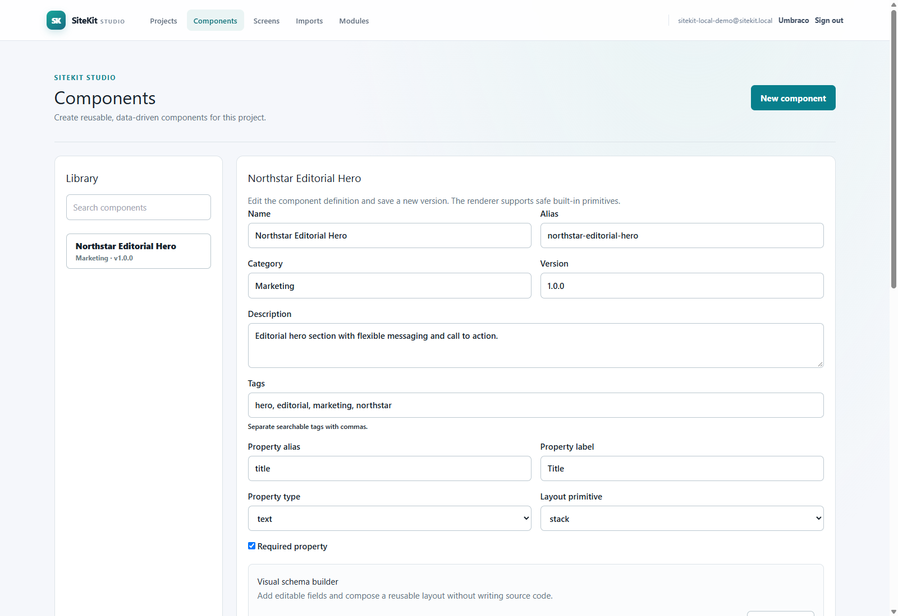
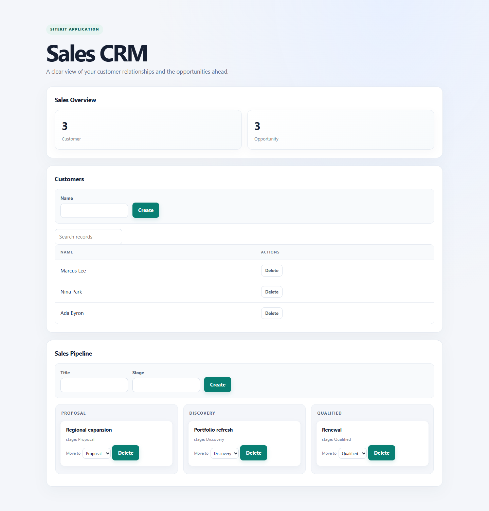
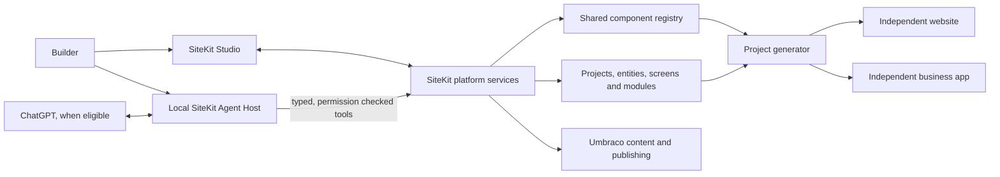

# SiteKit

<p align="center">
  
</p>

<p align="center"><strong>Build websites. Build business applications. Keep the building blocks.</strong></p>

SiteKit is an open-source platform for building content-driven websites,
database-backed business systems and reusable software modules on Umbraco.
Create components once, model operational data, compose application screens,
install modules, and generate independently deployable .NET projects. ChatGPT
can orchestrate SiteKit through a user-controlled local Agent Host and typed,
auditable tools.

> **Status:** Active development. This is the clean, product-first SiteKit
> repository. The earlier hotel application was a proof of concept and is not
> the product baseline. See the [implementation ledger](docs/SITEKIT_IMPLEMENTATION_PLAN.md)
> for what is implemented, partial or pending.

## One platform, many kinds of software

| Websites | Business applications | Reusable platform |
| --- | --- | --- |
| Marketing sites, blogs and directories | CRMs, portals and operational tools | Versioned components and themes |
| Events, stores and content experiences | Forms, tables, dashboards and pipelines | Typed entities, screens and workflows |
| Umbraco editorial content and publishing | Persistent records and permissions | Installable modules and project starters |

The hotel proof of concept is intentionally absent. Hospitality functionality
can return later as an optional module built on the same general platform.

## Product evidence

These captures document capabilities exercised in the original proof-of-
concept host before the clean repository extraction. They show real browser
sessions and generated .NET application output. They are **historical evidence**,
not a claim that the new Studio host already passes the same live journeys.

<p align="center">
  
</p>

<p align="center"><em>Component Studio · visual schema and layout editing</em></p>

<p align="center">
  
</p>

<p align="center"><em>Generated application · customer data and opportunity pipeline</em></p>

More captures and their exact provenance are in the [screenshot notes](docs/SITEKIT_SCREENSHOTS.md).

## How it fits together



## Repository layout

```text
src/
  SiteKit.Core/          Platform contracts, registries and generation
  SiteKit.AgentHost/     Local ChatGPT orchestration and MCP tools
  SiteKit.Studio/        Studio host and Umbraco adapters
tests/
  SiteKit.Core.Tests/    Core and generated-runtime contract tests
docs/                    Architecture, setup and implementation evidence
```

The hotel POC, booking engine, hotel exports, and hotel-specific database setup
are deliberately excluded from this repository. The Studio host initializes
Umbraco independently and uses a SiteKit-owned local administrator session and
JSON stores. Local development uses SQLite; the Docker stack uses an isolated,
persistent SQL Server database. See the implementation ledger for verified
behavior and open gaps.

## Start with the core and local agent

Install the .NET 10 SDK, then run:

```powershell
dotnet restore SiteKit.sln
dotnet test SiteKit.sln --configuration Release
dotnet run --project src/SiteKit.AgentHost -- help
```

For local AI orchestration, connect an eligible account using the official
Sign in with ChatGPT flow and separately grant plan usage:

```powershell
dotnet run --project src/SiteKit.AgentHost -- login
dotnet run --project src/SiteKit.AgentHost -- chat --project my-first-app
```

Eligibility and available model/tool capabilities depend on OpenAI's current
program rules. SiteKit does not collect passwords or cookies, proxy a user's
subscription through a shared server, or require an API key when supported plan
sharing is available. See the [Agent Host guide](docs/SITEKIT_AGENT_HOST.md).

## Build something reusable

Component definitions use validated schemas and safe rendering primitives. A
project refers to a shared component definition while supplying its own content
and appearance. Developers can author schemas in C# and export verified module
packages for reuse. See the [Component SDK](docs/SITEKIT_COMPONENT_SDK.md),
[module packages](docs/SITEKIT_MODULE_PACKAGES.md), and [generated app runtime](docs/SITEKIT_GENERATED_RUNTIME.md).

## Documentation

- [Implementation ledger and acceptance evidence](docs/SITEKIT_IMPLEMENTATION_PLAN.md)
- [Architecture and Umbraco integration](docs/SITEKIT_AI_AND_UMBRACO_INTEGRATION.md)
- [Data models and permissions](docs/SITEKIT_DATA_MODELS.md)
- [Imports](docs/SITEKIT_IMPORTS.md)
- [Automation](docs/SITEKIT_AUTOMATION.md)
- [Screenshots and their provenance](docs/SITEKIT_SCREENSHOTS.md)

## Contributing

Issues and pull requests are welcome. Start with [AGENTS.md](AGENTS.md) for
repository boundaries, security requirements and validation commands. Keep
features generic; package industry-specific behavior as modules.

## License

See [LICENSE](LICENSE).
