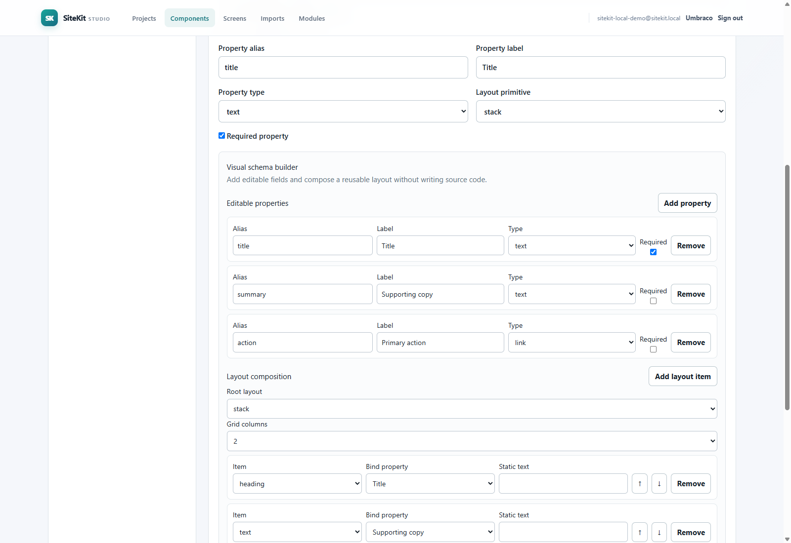
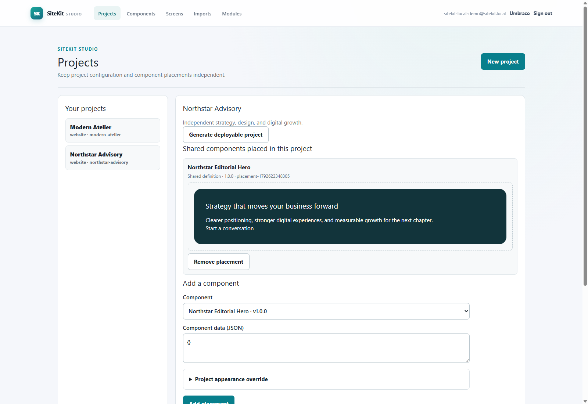
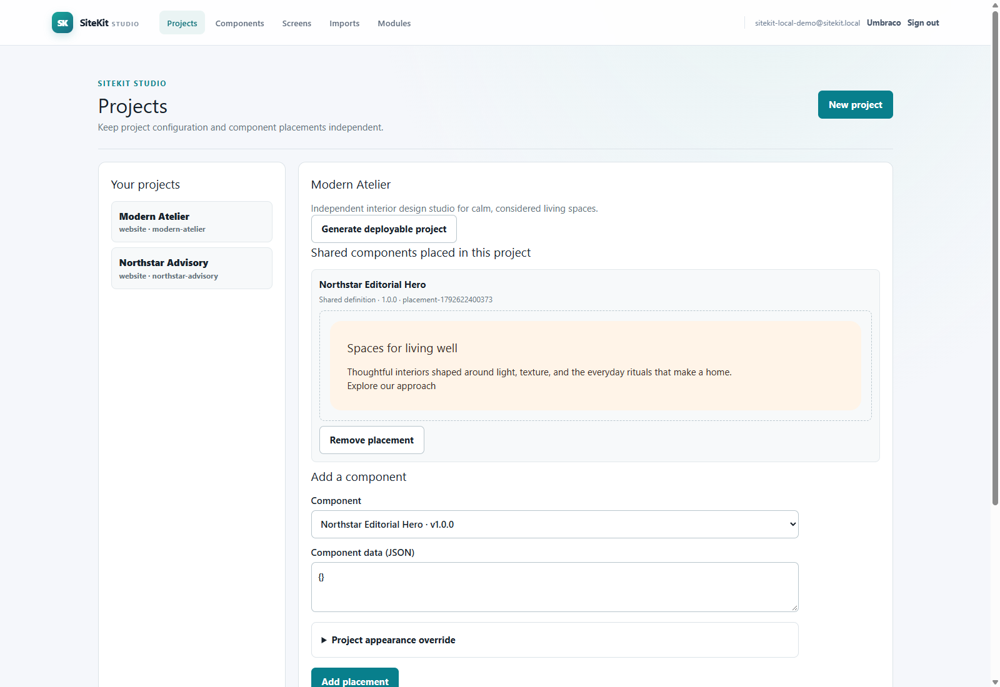

# SiteKit screenshot evidence

These are **historical local proof-of-concept captures** copied from the
previous repository. They show real browser sessions and generated .NET
application output from that host; they are not screenshots from the newly
extracted SiteKit host. Re-capture every Studio journey after the clean Umbraco
install and its APIs have been verified.

## Component Studio

The original host created a hero definition with text and link properties,
saved it to the shared component registry, then reused it with separate content
and appearance in two projects. Those API and browser checks were against the
proof-of-concept host and must be repeated here.

## Shared components across websites

| Northstar Advisory | Modern Atelier |
| --- | --- |
|  |  |

The original generated .NET sites referenced the same component definition with
project-specific copy and styling.

## Generated CRM

The generated runtime contract tests are re-run in the clean repository. The
historical browser capture depicts a local application with sample customers
and opportunities. It is not a hosted demo URL.
